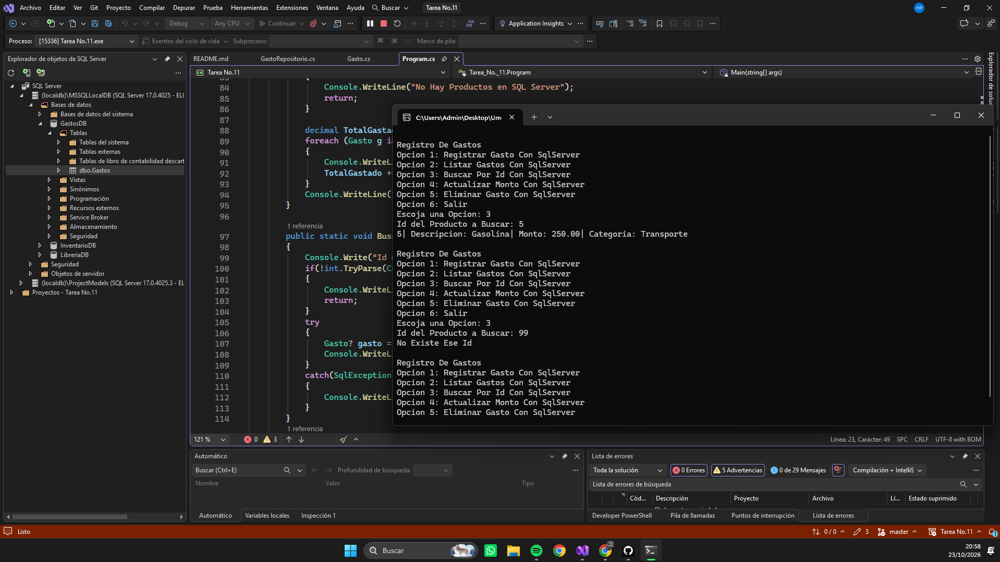
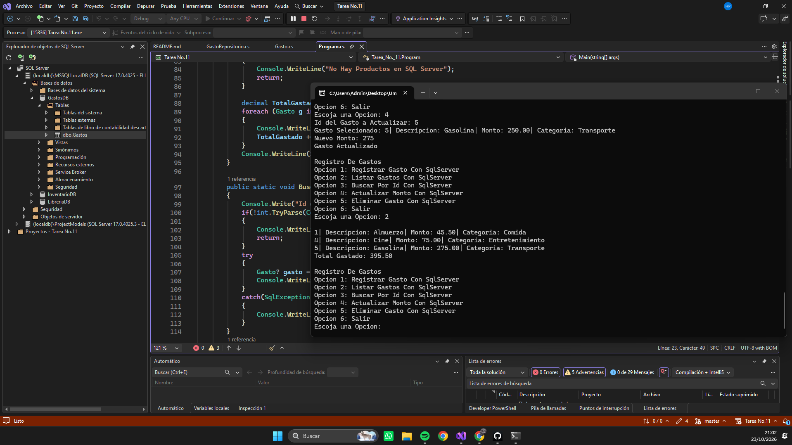
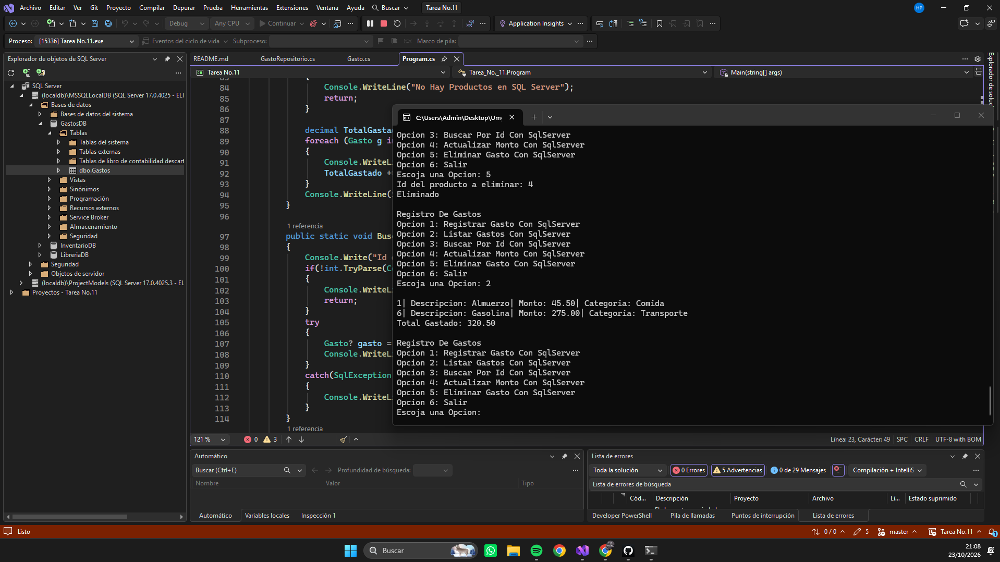
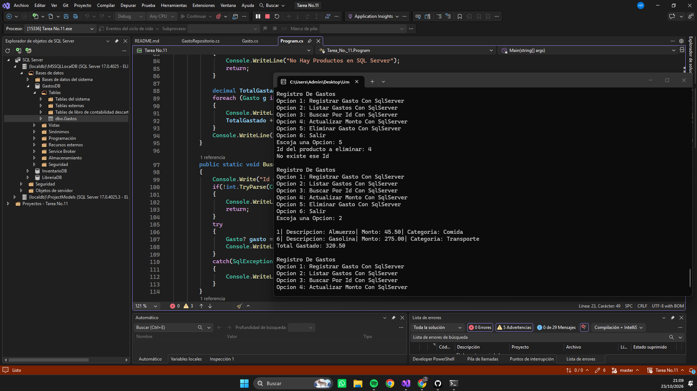
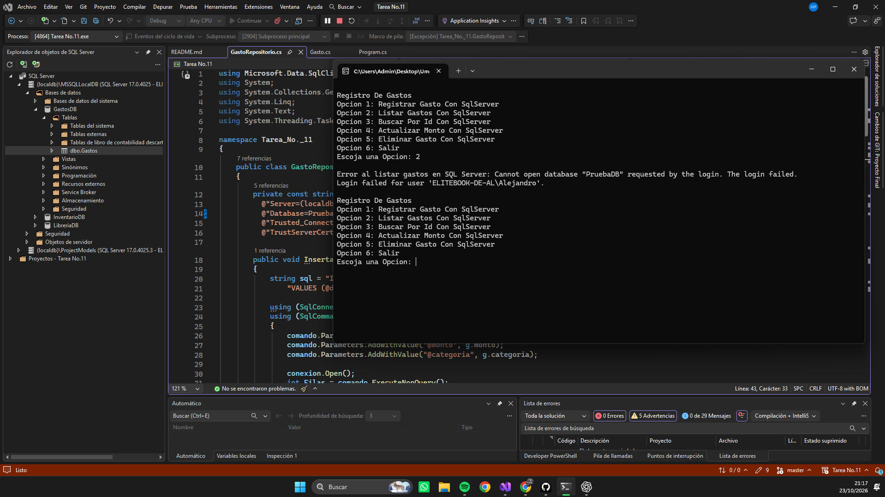

# Tarea No.11 Repositorio de Gastos Con Update y Delete

## Descripción

Programa desarrollado en C# que utiliza:

- Cadena de conexion a Base de datos
- SELECT FROM WHERE
- DELETE FROM WHERE
- UPDATE FROM WHERE
- Creacion de GastosDB en (localdb)\MSSQLLocalDB
- using
- SqlConnection
- SqlCommand
- SqlDataReader
- .ExecuteReader()
- .Read
- .Parameters.AddWithValue
- @Valor
- .GetInt32()
- .GetString()
- .GetDecimal()
- Interpolacion
- Ternario
- if
- Try/Catch

## Cómo ejecutar

- Abrir el proyecto en Visual Studio Community.
- Presionar **F5**.

O desde la terminal:

## Capturas
- Caso 1 y 2

- Caso3

- Caso 4

- Caso 5

## Video Explicativo
- https://drive.google.com/file/d/1UsZk94Ksv8iuENhrU6caD1t6iz0wTdSW/view?usp=sharing